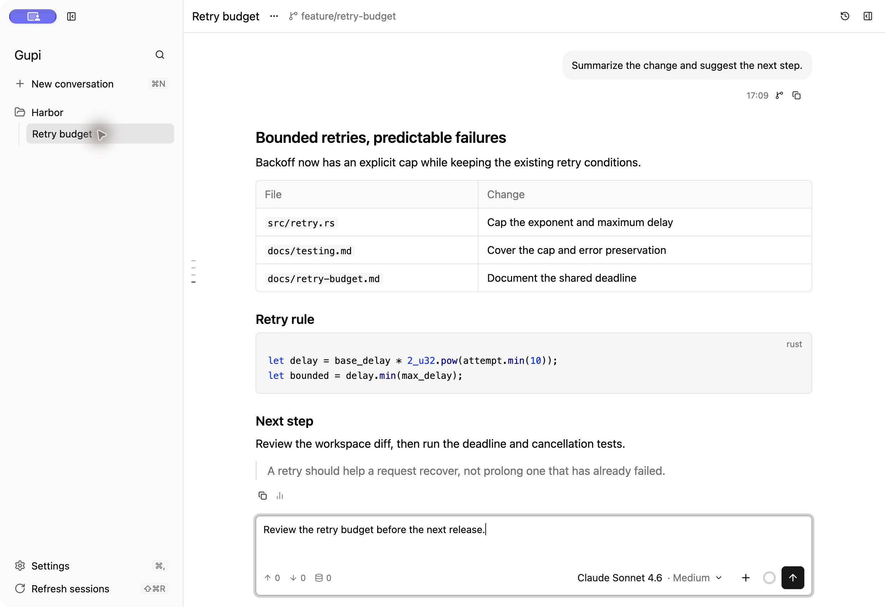
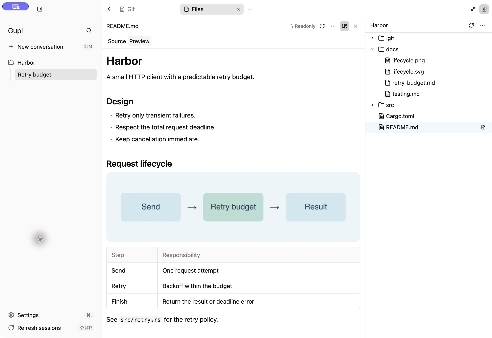
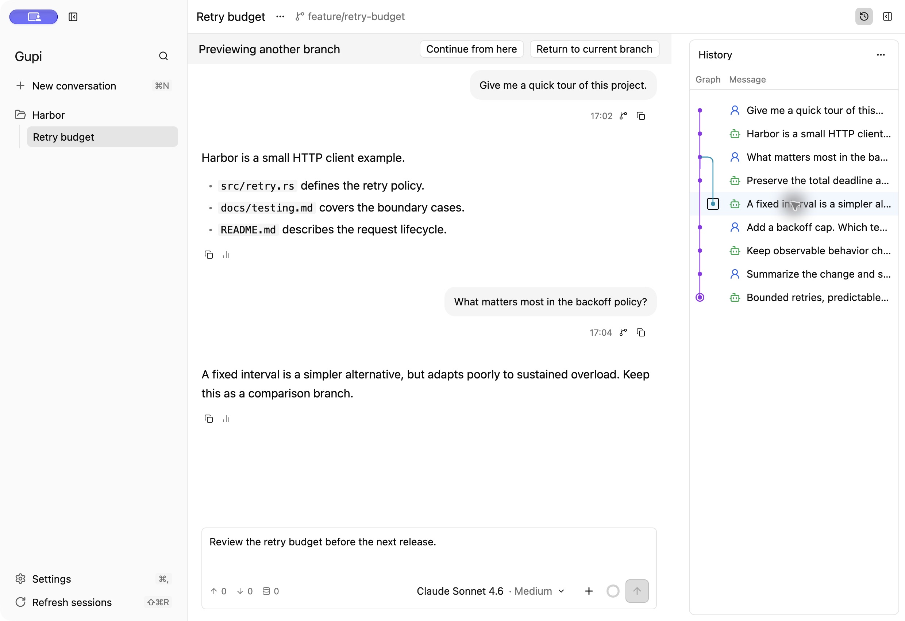
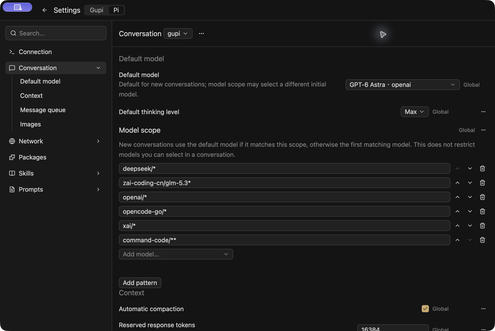
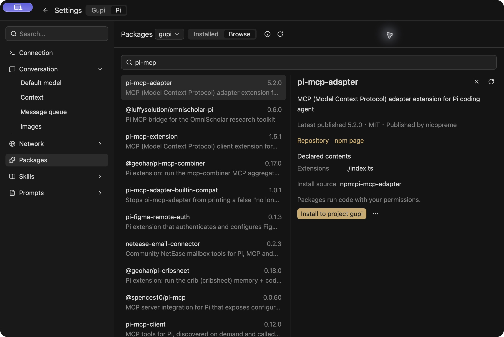

# Gupi

[English](README.md) · [简体中文](README.zh-CN.md)

**A native desktop workspace for [Pi](https://github.com/earendil-works/pi).** Organize project conversations, follow model and tool activity, explore history branches, and use temporary chats for quick tasks. Built with [GPUI Kit](https://github.com/longbridge/gpui-kit).



*Actual macOS interface, using an isolated example project and demonstration conversation.*

[Quick Start](#quick-start) · [Installation](#installation) · [Usage](#usage) · [Shortcuts and settings](#shortcuts-and-settings) · [FAQ](#faq)

## Quick Start

1. [Install and configure **Pi**](#prepare-pi). Confirm `pi --version` works in a terminal and configure your model account in Pi.
2. [Download Gupi for your platform](#download-gupi), install it, and launch the application.
3. Choose your language and appearance in the welcome flow. Let Gupi find Pi automatically, or enter its executable's absolute path. You can also configure this later in **Settings → Pi**.
4. Choose **New conversation** and select a project folder. Once connected, choose a model below the composer, write a request, and press **Enter**.

For a first task, try: `Read this project's README and explain what it does and how to run it.`

## Installation

Install with Homebrew on macOS, or download a prebuilt package from [GitHub Releases](https://github.com/suxiaoshao/gupi/releases/latest). WinGet is pending community inclusion; use the Windows MSI until the package appears in the public source.

### Prepare Pi

Gupi uses your existing Pi executable, model accounts, and session files. It does not bundle Pi or a model subscription. With Node.js and npm installed, follow [Pi's official instructions](https://github.com/earendil-works/pi/tree/main/packages/coding-agent#readme):

```sh
npm install -g --ignore-scripts @earendil-works/pi-coding-agent
pi --version
pi
```

In Pi, use `/login` for a supported subscription, or follow its [provider setup](https://github.com/earendil-works/pi/blob/main/packages/coding-agent/docs/providers.md) for API credentials. Select a model with `/model`. Use **Pi 1.1.0 or later** for the scoped settings and model-scope features described below.

On Windows, also configure your command environment using Pi's [Windows instructions](https://github.com/earendil-works/pi/blob/main/packages/coding-agent/docs/windows.md). If you use a Node.js version manager, make sure the process launching Gupi can find both Pi and Node.js.

### Homebrew (macOS)

```sh
brew install --cask suxiaoshao/tap/gupi
```

The [maintainer tap](https://github.com/suxiaoshao/homebrew-tap) installs the signed, notarized DMG for your Mac's architecture. Pi remains a separate prerequisite. To update or uninstall:

```sh
brew update
brew upgrade --cask --greedy suxiaoshao/tap/gupi
brew uninstall --cask suxiaoshao/tap/gupi
```

`--greedy` includes Gupi's Cask even though the app has its own updater. Uninstall keeps your Gupi preferences and Pi data.

### Download Gupi

| Platform | Download v0.1.9 | Installation |
| --- | --- | --- |
| macOS · Apple silicon | [DMG](https://github.com/suxiaoshao/gupi/releases/download/v0.1.9/Gupi_0.1.9_aarch64_macos.dmg) · [ZIP](https://github.com/suxiaoshao/gupi/releases/download/v0.1.9/Gupi_0.1.9_aarch64_macos.zip) | Open the DMG and drag `Gupi.app` to Applications, or extract the ZIP and move the app there. |
| macOS · Intel | [DMG](https://github.com/suxiaoshao/gupi/releases/download/v0.1.9/Gupi_0.1.9_x86_64_macos.dmg) · [ZIP](https://github.com/suxiaoshao/gupi/releases/download/v0.1.9/Gupi_0.1.9_x86_64_macos.zip) | Open the DMG and drag `Gupi.app` to Applications, or extract the ZIP and move the app there. |
| Windows · x64 | [English MSI](https://github.com/suxiaoshao/gupi/releases/download/v0.1.9/Gupi_0.1.9_x64_en-US.msi) · [All installer languages](https://github.com/suxiaoshao/gupi/releases/tag/v0.1.9) | Run the MSI, complete the installation, and open Gupi from the Start menu. |
| Linux · x64 Debian/Ubuntu | [deb](https://github.com/suxiaoshao/gupi/releases/download/v0.1.9/Gupi_0.1.9_amd64.deb) | Run `sudo apt install ./Gupi_0.1.9_amd64.deb`, then launch Gupi in a graphical desktop session. |

macOS packages require macOS 11 or later and are signed with Developer ID and notarized by Apple. Windows installers are not yet Authenticode-signed, so Windows may show an unknown publisher. Linux packages are also unsigned. The release includes `SHA256SUMS` for checking downloaded files.

Windows 0.1.7 statically links the Visual C++ runtime in the application and update helper; no separate runtime installation is required. Version 0.1.6 bundled the runtime DLLs. If an older release fails with missing `VCRUNTIME140.dll` or error `0xc0000135`, upgrade to the latest MSI or install Microsoft's [x64 Visual C++ Redistributable](https://aka.ms/vc14/vc_redist.x64.exe). Previously published installers have not been replaced.

<details>
<summary>Build from source or create local packages</summary>

### Build requirements

Install Git and [Rustup](https://rustup.rs/). The repository's [rust-toolchain.toml](rust-toolchain.toml) selects the required Rust version. Prepare your platform's dependencies below, then clone and run Gupi:

```sh
git clone https://github.com/suxiaoshao/gupi.git
cd gupi
cargo run -p gupi --locked
```

<details>
<summary>macOS · Apple silicon and Intel</summary>

Use full Xcode and select its developer directory:

```sh
sudo xcode-select --switch /Applications/Xcode.app/Contents/Developer
xcrun metal --version
```

If the Metal compiler is missing, run `xcodebuild -downloadComponent MetalToolchain`.

</details>

<details>
<summary>Windows · x64</summary>

Install Visual Studio Build Tools with **Desktop development with C++**, including the Windows SDK. Use the Rust **MSVC** toolchain and run build commands in a developer PowerShell or command prompt.

</details>

<details>
<summary>Linux · x64 Debian/Ubuntu</summary>

Ubuntu 22.04 dependencies match the repository's [setup action](.github/actions/setup/action.yml):

```sh
sudo apt-get update
sudo apt-get install --no-install-recommends -y \
  build-essential pkg-config clang dpkg-dev binutils \
  libwayland-dev libxkbcommon-dev libxkbcommon-x11-dev \
  libegl1-mesa-dev libvulkan-dev libfontconfig1-dev libfreetype6-dev \
  libxcb1-dev libx11-dev libxcursor-dev libxi-dev libxrandr-dev libgbm-dev
```

Run Gupi in a graphical desktop session. Other distributions need the corresponding system libraries.

</details>

<details>
<summary>Optional: Nix development environment on macOS / Linux</summary>

The repository provides `nix develop`; inside the shell, run `cargo run -p gupi --locked`. macOS still requires full Xcode and Metal tools.

</details>

### Local application packages

Build a package locally if you prefer launching an installed app to using `cargo run`:

| Platform | Package location | Installation |
| --- | --- | --- |
| macOS Apple silicon | `dist/aarch64-apple-darwin/*.{dmg,zip}` | Open the DMG and drag `Gupi.app` to Applications, or extract the ZIP. |
| macOS Intel | `dist/x86_64-apple-darwin/*.{dmg,zip}` | Open the DMG and drag `Gupi.app` to Applications, or extract the ZIP. |
| Windows x64 | `dist/x86_64-pc-windows-msvc/*.msi` | Open the MSI for your preferred installer language. |
| Linux x64 | `dist/x86_64-unknown-linux-gnu/*.deb` | Run `sudo apt install ./dist/x86_64-unknown-linux-gnu/*.deb`. |

<details>
<summary>Show local packaging commands</summary>

On macOS/Linux, leave any Nix shell first. Use native Rustup and system libraries, with a separate build directory:

```sh
# macOS
CARGO_TARGET_DIR=target/native MACOSX_DEPLOYMENT_TARGET=11.0 \
  cargo run -p xtask --locked -- bundle

# Linux
CARGO_TARGET_DIR=target/native cargo run -p xtask --locked -- bundle
```

On Windows:

```powershell
cargo run -p xtask --locked -- bundle
```

</details>

Local macOS packages default to development ad-hoc signing and are not notarized; downloaded development packages remain subject to Gatekeeper checks. Windows and Linux packages are currently unsigned. See [Release packaging](docs/releasing.md) for formal signing and target options.

</details>

## Usage

### Projects and sessions

The sidebar groups conversations by project. Open a session to resume it, or press **Cmd/Ctrl+P** to search. Each session keeps its own draft. Use **Refresh sessions** to discover sessions created or changed in terminal Pi.

The folder selected when creating a session becomes Pi's working directory and cannot be changed later. The titlebar shows its Git branch, or a short commit ID for detached HEAD. Session menus provide rename, reveal paths, stop generation, end the running connection, and move to Trash.

### Project files and source

Open the right-hand workspace and choose **Files** from its New Tab page to browse the current conversation's project directory. Click folders to expand or collapse them, refresh after external changes, and select a text file to open its read-only source preview.



The preview supports syntax highlighting, line numbers, selection, copying, search and line wrapping. It shows a snapshot: use **Reload** to read changes from disk. Opening the same file again preserves its reading position and search state. Previewing does not edit or save the file, or send its content to the model; use `@` in the composer to reference it in a message.

The workspace keeps Files, Git workspace changes and each reply's Changes in separate tabs. Drag tabs to reorder them, use the tab menu to close groups, or maximize the workspace. File previews keep the file tree available. Conversation history has its own panel beside the conversation.

After an agent reply, choose **View changes** on its file-change card to open that reply's Changes tab. Keep several replies' tabs open to compare recorded edits. Repeated edits to the same file are composed where possible; unsupported chains fall back to individual operations. These cards describe recorded `edit`/`write` tool calls, not a Git diff or changes made through shell commands, and provide no rollback action. Temporary conversations retain inline diffs.

Choose **Changes** from the workspace launcher to read the repository's actual **Unstaged**, **Staged** or **Untracked** changes. The read-only reader keeps these sources separate from Pi's recorded edits. Filter paths, step between files, choose unified or split view, expand context, wrap lines and copy patches or available file versions. Narrow diff areas use unified view. Binary files, conflicts and oversized or unavailable content show explicit states; this view does not stage, discard or commit changes.

`@` completion follows Pi's path matching and ranking, including hidden files, ignore rules, quoted paths with spaces, and relative/home/absolute directories. Choosing a directory continues browsing; choosing a file inserts its reference without sending a message.

Use arrow keys to navigate the file tree and **Enter** to open a file. **Cmd/Ctrl+F** searches the focused source editor, composer or message area. Text previews are limited to 1 MiB and 20,000 lines; unsupported encodings, binary files and oversized files show an explanation.

On Windows and Linux, application menus and window controls occupy the top row; conversation and page actions sit below it. Drag the blank area in the top row to move the window. macOS uses its system menu bar. Upgrading from 0.1.3 resets old window-position and pane-width preferences once; subsequent layout choices are saved.

### Messages and attachments

| Action | How |
| --- | --- |
| Send a message | **Enter** |
| Add a line break | **Shift+Enter** |
| Steer a running response | Write another message and press **Enter**. Pi applies its steering behavior. |
| Queue a follow-up | **Alt+Enter** |
| Stop generation | Use Stop or **Esc** after closing any active popup. |
| Reference a file or folder | Type `@` to search the current project, or choose a file/folder from the attachment menu. |
| Add an image | Use the attachment menu, paste an image, or drag it into the composer. |
| Use a skill or prompt | Open the command palette, select the resource, then finish your message. Selection does not send it. |

File references appear as path tokens inside the message. Images appear as separate attachments; click a thumbnail for a larger preview. Image support and limits depend on the selected Pi model.

When sending fails, Gupi keeps the draft and attachments for you to retry. Queued messages follow Pi's queue behavior.

### Models, responses, and tools

Responses render as Markdown with code blocks, lists, and tables. Expand a process section to inspect thinking and tool calls, or open tool details to read and copy their content. Click a local file resource to open it with the system's default application.

With Pi 1.3.0, recorded direct Shell commands appear as separate rows with output, exit status and a marker when excluded from model context. Active commands can show live output and a Stop action; long output supports expansion, copying, search and opening Pi's full-output file when available. The dedicated Shell input is not available yet: typing `!` or `!!` in the composer still sends a normal message.

With focus in conversation messages, **Cmd/Ctrl+F** searches that conversation. In the composer or source editor, it searches that control’s own text. Token totals and the context indicator below the composer open usage details. The model control also lets you change the thinking level when the selected model supports it.

From four user messages onward, a navigator appears in the reading area's left margin when space permits. Hover or focus a tick to preview the question and an excerpt of its answer; click or drag across ticks to jump. **Alt+Up / Alt+Down** moves between user messages within the reading area. Previews use existing conversation text and do not request model summaries.

Extensions can ask you to select an option, confirm an action, enter a line of text, or edit longer text. Answer in the conversation's input area. Gupi also displays extension notifications, status text, and text widgets; custom terminal interfaces are not supported.

### History and branches

Open **Conversation history** in the title bar, or press **Cmd/Ctrl+Alt+B**.



- Use the history panel's **⋯** menu to switch between **tree** and **list**, then choose the amount of detail: Brief, Detailed, or All records. The panel docks beside the conversation or opens as an overlay when space is limited.
- Select a node to preview that branch. Previewing keeps your draft and the real execution position; ordinary sending is paused while you view another branch.
- Right-click a history node and choose **Continue from here** to change the execution position within the same session. User messages return to the composer for editing; other nodes become the point to continue from. The session must be idle.
- Use **Fork** on a user message to open a new session from before that question. Pi puts the question back in the new composer so you can revise it.
- Return to the actual execution position to continue the original session.

In the tree, drag or scroll to pan, pinch or hold Cmd/Ctrl while scrolling to zoom, and use the toolbar to fit the tree or locate the current node. Click a collapsed connection to expand its records.

To reuse the whole session, choose **Duplicate conversation** from its menu. To save a readable copy, choose **Export conversation as HTML** and select a destination. Both require an idle, connected session; cloning also requires existing history. HTML exports contain conversation content, so review them before sharing.

### Temporary conversations and quick tasks

Open **Temporary conversation** from the application or tray menu. On macOS and Windows, you can assign a global shortcut in **Settings → Keyboard shortcuts**. Linux does not currently have a global-shortcut backend.

Temporary conversations are useful for a translation, a short explanation, or another task you do not want in the project sidebar. You can keep several in the temporary window and search their titles. Hiding the window does not stop a running response.

- Use **Cmd/Ctrl+K** for actions such as copy, paste back, choose model, show the working directory, or delete the temporary conversation.
- With no message or attachment to send, **Enter** pastes the selected conversation's last complete answer back into the previously active app. In the search field or list, Enter also pastes back.
- **Cmd/Ctrl+Enter** in the search/list/actions area copies the answer and leaves the window open.
- Paste-back on macOS needs Accessibility permission. If it cannot paste, the answer stays on the clipboard for manual pasting.

Personal prompt templates can become shortcut tasks using selected text, clipboard input, or a screenshot, with an optional model and thinking level for that task.

For screenshot input on macOS and Windows, Gupi freezes all displays before you select a region, with overlays covering each full display. Releasing the drag crops the selected frame and automatically submits it with the task template. Escape or right-click cancels without sending. On macOS, Gupi requests Screen Recording permission when you first capture. If access is denied, enable Gupi in System Settings → Privacy & Security → Screen Recording and retry; restart Gupi if macOS requests it.

**Temporary conversation history is not saved.** These conversations cannot currently be converted into persistent sessions. Their workspaces may contain files generated by tools; use the session's Trash action or the cleanup control in General settings when those files are no longer needed.

### Pi settings: global and project scopes



These settings require **Pi 1.1.0 or later**. Check `pi --version` and update Pi using its installation instructions if needed.

Open **Settings → Pi** for connection, conversation, network and resource settings. Use the scope menu to choose **Global** or a project folder. The conversation's **Project Pi settings…** action opens its working directory directly; selecting a folder does not grant trust or create configuration files.

**Conversation** includes the default model/thinking level, model scope, compaction, message queues and image handling. **Network** includes retries and a global Pi HTTP proxy; the proxy does not change Gupi's network requests. **Connection** controls Gupi's Pi executable separately.

With Pi 1.2.0 or later, **Tools & environment** edits default tools, Codemode, shell/command options, installation telemetry and the global default project-trust policy. Conversation settings include per-model thinking and compaction overrides; network settings include timeouts and provider-specific retries. The startup tool preview follows Pi's configuration rules and does not restrict what extensions or MCP may enable.

Values show their source: default, global or project. A project inherits global values unless it overrides them. Field menus let you set an explicit project value or restore inheritance. Changes remain drafts until you choose **Save** for that page; leaving with unsaved changes offers Save, Discard or Cancel. If another program changed the same field, reload before editing again. Saving preserves unrelated settings.

An untrusted project is marked as such. **Trust project…** explicitly allows Pi to load that folder's settings/resources and execute its project extensions; saving settings alone does not trust the project. Reconnect running conversations when they need to load saved settings or resources. New conversations read the new configuration.

### Initial model scope

Under **Pi → Conversation**, **Model scope** is an ordered list. Add a model from the picker or enter a pattern, then edit, move or remove rows. Patterns may use globs such as `provider/*` and thinking suffixes such as `:high`. Pi resolves the patterns against available models.

New conversations use the default model if it matches the scope; otherwise they use the first matching model. This does not filter the in-conversation model picker or change an existing conversation's model on reconnect. A project list replaces the global list: an explicit empty list means **Unrestricted (overrides global)**, while restoring inheritance uses the global scope.

### Packages, skills, and prompts



The **Packages**, **Skills**, and **Prompts** pages share the selected global/project scope:

- Under **Packages → Browse**, search npm packages tagged `pi-package`, select one to inspect its published details and declared resources, then install it into the chosen scope. You can also install from a known source. These operations run through Pi; inspecting a package does not install it.
- View installed packages without registry access. Global packages support updates; project packages currently support installation/removal. Inherited global packages and direct editing of package-filter arrays remain read-only in the project view.
- Create or edit your own Skills, prompt templates, `SYSTEM.md` and `APPEND_SYSTEM.md` in the selected scope. Project files live under `.pi/`; personal resources come from `PI_CODING_AGENT_DIR` (normally `~/.pi/agent`) and personal `~/.agents/skills`.
- Inspect resource origins, disabled states and project/global groups. Package-owned and external file contents are read-only; project extensions, themes and explicit resource paths are displayed without executing them. Switch to Global to enable/disable personal resources.

Browsing contacts the npm registry. At narrow widths, package details replace the list and provide a Back action; at wider widths, drag the divider to adjust the detail area. After external changes, refresh the page and reconnect conversations that need to load the changes.

Under **Tools & environment → Resource paths**, edit the current scope's ordered `extensions`, `skills`, `prompts` and `themes` arrays. Missing keys and explicit empty lists remain distinct; these arrays are not shown as merged inheritance. Project-owned resources and resources from project packages support enable/disable switches. Inherited global resources and project package-filter editing remain read-only.

### Model providers and MCP files

With Pi 1.2.0 or later, **Pi → Models & providers** edits the global `models.json`, including provider definitions, models and model overrides. **Pi → MCP** edits the global or project `mcp.json`: add stdio/HTTP servers or project overrides of global servers. Pi loads project MCP configuration only for trusted projects.

These pages edit the files as written rather than previewing effective merged settings. Stage changes in the entry dialog, then save the page to write the file. Existing credential values are never displayed; use Replace or Remove. `${NAME}` and `!command` values are stored without evaluation. Saving `models.json` removes comments and normalizes formatting. MCP conflict detection rereads before saving but cannot lock out concurrent Pi writes. Reconnect an existing conversation, or start a new one, to load saved MCP configuration.

On **Pi → Authentication**, manage global provider credentials stored by Pi: add or replace an API key, remove a saved credential, or log out a saved OAuth account. Secret values are never displayed. Provider OAuth login still takes place in terminal Pi using `/login <provider>`. **Check configuration** asks Pi to inspect local authentication configuration without contacting the provider or refreshing tokens; a ready result does not verify that a token works. Credential removal does not revoke server-side authorization or remove other authentication sources. New sessions fully load credential changes.

On **Pi → MCP**, save or discard edits before using a server's **Log in** or **Log out** action. Supported HTTP OAuth servers use Pi's browser login flow; logging out removes local credentials without revoking server authorization. **Check connection** actually connects to enabled servers in the selected scope and may run configured commands or refresh tokens. Results describe the last check, not live session state; cancel if needed. Project checks respect Pi's trust rules. Reconnect running conversations to fully load saved configuration. These controls use Pi's built-in MCP, and do not manage a replacement extension's connections.

## Shortcuts and settings

### Common shortcuts

**Cmd/Ctrl+Shift+P** opens the command palette. Search by the action's label or Pi command name, such as `model`, `thinking`, `tree`, `fork`, `export`, `clone`, or `compact`. Compaction asks Pi to summarize the current context; its progress and any errors appear in the session.

| Default shortcut | Action |
| --- | --- |
| Cmd/Ctrl+N | New conversation |
| Cmd/Ctrl+P | Search conversations |
| Cmd/Ctrl+Shift+P | Command palette |
| Cmd/Ctrl+F | Search the focused messages, draft, or source editor |
| Cmd/Ctrl+L | Focus the composer |
| Cmd/Ctrl+Alt+/ | Model and thinking |
| Cmd/Ctrl+Alt+B | Conversation history |
| Cmd/Ctrl+B | Show/hide the session sidebar |
| Cmd/Ctrl+R | Reconnect the current session |
| Cmd/Ctrl+Shift+R | Refresh the session catalog |
| Cmd/Ctrl+, | Settings |

Here **Cmd** is used on macOS and **Ctrl** on Windows/Linux. Customize bindings in **Settings → Keyboard shortcuts**. Menu items and button hints display the current bindings.

Search shortcuts by command name or key combination, or show only customized bindings. Record a replacement inline, then save or cancel it; conflict feedback links to the command already using that shortcut. Scope descriptions explain where each command applies.

### Appearance, language, and notifications

Use **Settings → Appearance** for system/light/dark appearance, separate light and dark theme choices, and icon styles. The interface supports English, Simplified Chinese, Traditional Chinese, Japanese, Korean, German, French, Spanish, and Brazilian Portuguese, with seven icon styles. Language and appearance changes apply immediately. macOS native dialogs use the selected language after restarting Gupi; Windows native dialogs follow the Windows display language.

**Settings → Notifications** controls waiting-for-input, failure, completion, and plugin notifications. By default, completed answers notify you while the app is in the background. The session sidebar shows unread answers and waiting/error states; clicking a notification returns to its source without answering a question for you.

macOS system notifications require an application bundle and system permission. Focus settings may affect delivery. Global shortcut support is limited to macOS/Windows, and automatic paste-back may require platform permissions.

### Updates

Choose **Gupi → Check for updates…**, or open **Settings → About → Updates**. Gupi checks stable GitHub Releases and links to the matching release notes and downloads. Packaged builds check automatically after startup and once per hour; you can turn this off in About. Source builds default to manual checks.

On macOS, choose **Download and install…** when a new version is available, then follow the update window. Use **Show update progress…** to bring that window back. Before installation, Gupi saves drafts, closes Pi connections, and restarts into the new version. Downloads begin only when you choose. Skipping a version stops automatic reminders for that version; you can still check and install it manually.

Windows in-app installation is currently unavailable. Quit Gupi, download the latest MSI in your installed language from the release page, and run it to upgrade manually. Version checks and release/download links remain available. WinGet distribution is still pending community inclusion.

While settings are being saved, **Download and install…** is disabled. Settings changes are disabled while the update window is open and become available again when it closes and any pending save finishes.

If the install button is unavailable, use the release page or your original package manager. Development macOS packages use manual downloads; Linux updates use the system package manager. Checking for updates does not interrupt Pi or change its version, extensions, or sessions.

## FAQ

| Symptom | What to check |
| --- | --- |
| Pi cannot be found | Run `pi --version` in your terminal. Set the executable's absolute path in **Settings → Pi**, check it, and reconnect the session. |
| Pi works in a terminal but not from the Dock | Use **Check Pi** to refresh command discovery. Gupi reads the login shell's `PATH` on macOS; other required environment variables must also be available, or launch Gupi from your configured terminal. |
| Windows cannot find Pi | Put Pi/Node.js on the user or system `PATH`, or launch Gupi from a terminal with the correct environment. Gupi does not load PowerShell profiles itself. |
| The executable check passes, but a model request fails | Verify the provider login, selected model, and credentials in Pi. Read the error in the affected conversation. |
| Build fails on macOS | Verify that full Xcode is selected and `xcrun metal --version` succeeds. |
| Notifications do not appear on macOS | Use an application bundle and enable notifications in macOS settings; Focus can also suppress delivery. |

**Check Pi** verifies the executable version, not your model account; Pi manages accounts, credentials, and model requests. Gupi does not reproduce every terminal extension interface.

### Data and diagnostics

| Data | Location |
| --- | --- |
| Gupi preferences | `gupi/config.toml` in the system configuration directory |
| Window layout and unsent drafts | `state.toml` and `conversations.toml` alongside the configuration |
| Pi sessions and credentials | Managed by Pi, using its configured directories |
| macOS logs | `~/Library/Logs/gupi/gupi.log` |
| Windows/Linux logs | `gupi/logs/gupi.log` in the system local-data directory |

The default configuration directory is `~/Library/Application Support/gupi` on macOS, `%APPDATA%\gupi` on Windows, and `$XDG_CONFIG_HOME/gupi` (normally `~/.config/gupi`) on Linux. `GUPI_CONFIG_DIR`, `GUPI_LOG_DIR`, and `GUPI_DATA_DIR` override Gupi's configuration, logs, and application-data directories. Relative overrides resolve from the launch working directory.

Use **Help** to open the documentation or log location and copy basic diagnostics. Diagnostics exclude conversation text, credentials, and environment variables. Review logs or exported conversations before attaching them to a [bug report](https://github.com/suxiaoshao/gupi/issues/new/choose).

## Development and feedback

- [Development index](docs/dev/README.md) — architecture and current design documents, primarily in Chinese.
- [Release packaging](docs/releasing.md) — native builds, signing, and package formats.
- [Gupi / Pi responsibilities](docs/gui-boundary.md) — application and runtime ownership.
- [Contribution conventions](AGENTS.md) — repository layout and focused validation.

The root `gupi` package is the application. Internal crates live in `crates/`; dependency versions are defined by `Cargo.toml` and `Cargo.lock`.

Report problems or suggestions through [GitHub Issues](https://github.com/suxiaoshao/gupi/issues/new/choose). See the [developer reference](docs/dev/pi-rpc-gaps.md) for the full Pi integration boundary.

## License

Gupi's source is licensed under the [MIT License](LICENSE). Its icons are derived from Pi visual assets by Earendil Inc. and contributors; the attribution, source references, and upstream MIT license are included in [Third-party notices](THIRD_PARTY_NOTICES.md) and distributed with the application. See the [icon source notes](build-assets/icon/README.md) for Gupi's adaptations. Gupi is an independent project and is not endorsed by Pi or Earendil.
