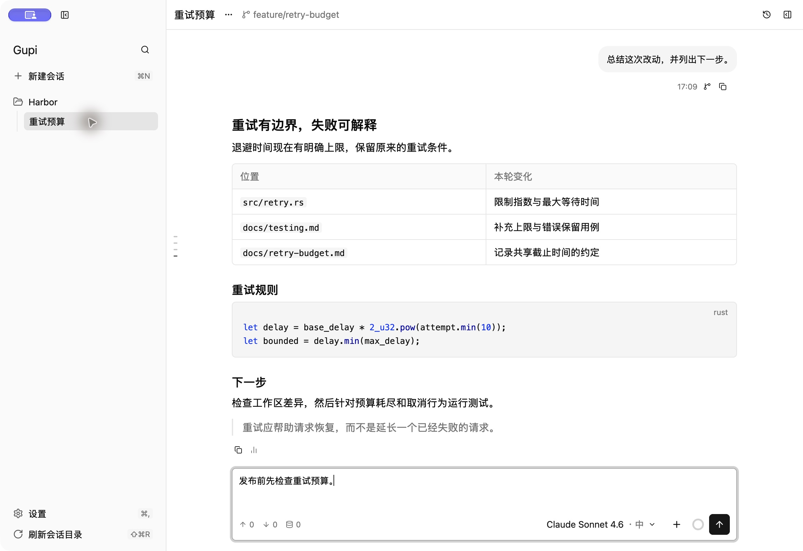
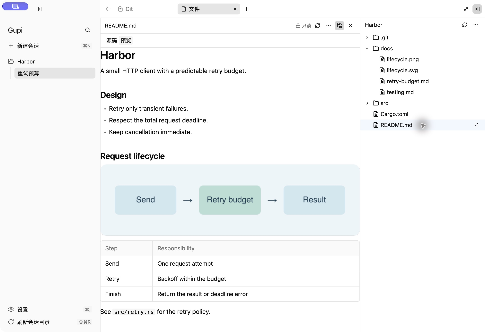
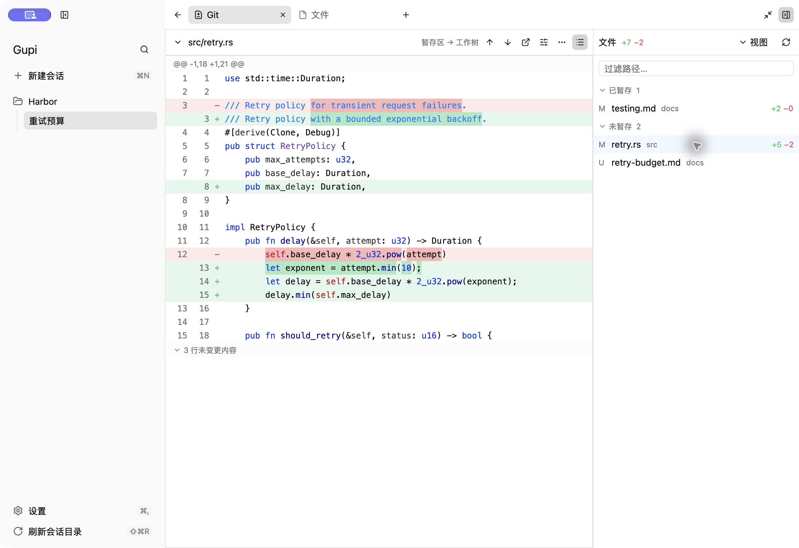
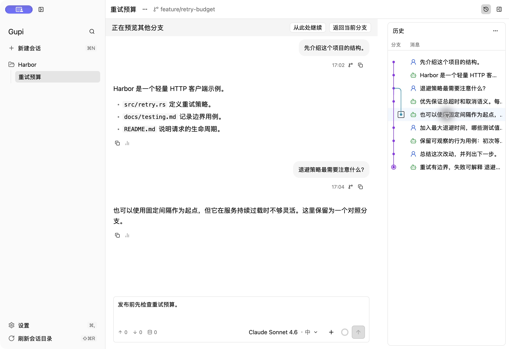
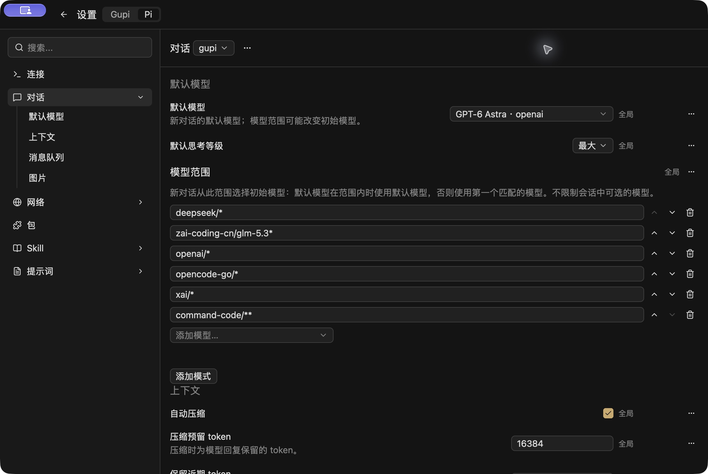
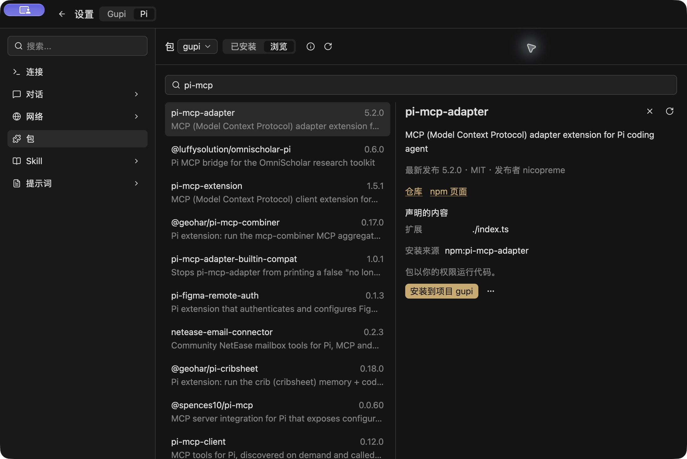

# Gupi

[English](README.md) · [简体中文](README.zh-CN.md)

**为 [Pi](https://github.com/earendil-works/pi) 提供原生桌面工作区。** 按项目整理会话，查看模型与工具的工作过程，探索历史分支，用临时对话完成随手的小任务。基于 [GPUI Kit](https://github.com/longbridge/gpui-kit) 构建。



*macOS 上的实际界面，使用隔离的示例项目和演示会话。*

[快速开始](#快速开始) · [安装](#安装) · [使用方法](#使用方法) · [快捷键与设置](#快捷键与设置) · [常见问题](#常见问题)

## 快速开始

1. [安装并配置 **Pi**](#准备-pi)。在终端确认 `pi --version` 正常，并在 Pi 中配置好模型账户。
2. [下载适合系统的 Gupi 安装包](#下载-gupi)，完成安装并启动应用。
3. 在首次引导中选择语言与外观，自动查找 Pi，或填写其可执行文件的绝对路径。也可以稍后在 **设置 → Pi** 中配置。
4. 点击 **新建会话**，选择项目文件夹。连接就绪后，在输入框下方选择模型，输入需求并按 **Enter**。

第一次可以试试：`阅读这个项目的 README，介绍它的用途和运行方式。`

## 安装

macOS 可以通过 Homebrew 安装，也可以从 [GitHub Releases](https://github.com/suxiaoshao/gupi/releases/latest) 下载预编译安装包。WinGet 待社区收录，进入公共源前请使用 Windows MSI。

### 准备 Pi

Gupi 使用已有 Pi 命令、模型账户和会话文件，不内置 Pi 或模型订阅。安装 Node.js 和 npm 后，按 [Pi 官方说明](https://github.com/earendil-works/pi/tree/main/packages/coding-agent#readme)安装：

```sh
npm install -g --ignore-scripts @earendil-works/pi-coding-agent
pi --version
pi
```

在 Pi 中使用 `/login` 登录支持的订阅，或按[提供方配置说明](https://github.com/earendil-works/pi/blob/main/packages/coding-agent/docs/providers.md)配置 API 凭据，再用 `/model` 选择模型。下述分作用域设置与模型范围功能需要 **Pi 1.1.0 或更高版本**。

Windows 用户还需按 Pi 的 [Windows 说明](https://github.com/earendil-works/pi/blob/main/packages/coding-agent/docs/windows.md)配置命令环境。通过版本管理器安装 Node.js 时，请确保启动 Gupi 的进程也能找到 Pi 和 Node.js。

### Homebrew（macOS）

```sh
brew install --cask suxiaoshao/tap/gupi
```

[维护者 tap](https://github.com/suxiaoshao/homebrew-tap) 会按 Mac 架构选择已签名、公证的 DMG。Pi 仍需单独安装配置。更新或卸载：

```sh
brew update
brew upgrade --cask --greedy suxiaoshao/tap/gupi
brew uninstall --cask suxiaoshao/tap/gupi
```

Gupi 带有内置更新功能，`--greedy` 会将它的 Cask 纳入 Homebrew 升级。卸载会保留 Gupi 偏好和 Pi 数据。

### 下载 Gupi

| 平台 | 下载 v0.1.12 | 安装方法 |
| --- | --- | --- |
| macOS · Apple 芯片 | [DMG](https://github.com/suxiaoshao/gupi/releases/download/v0.1.12/Gupi_0.1.12_aarch64_macos.dmg) · [ZIP](https://github.com/suxiaoshao/gupi/releases/download/v0.1.12/Gupi_0.1.12_aarch64_macos.zip) | 打开 DMG，将 `Gupi.app` 拖到“应用程序”；也可以解压 ZIP 后将应用移入该目录。 |
| macOS · Intel | [DMG](https://github.com/suxiaoshao/gupi/releases/download/v0.1.12/Gupi_0.1.12_x86_64_macos.dmg) · [ZIP](https://github.com/suxiaoshao/gupi/releases/download/v0.1.12/Gupi_0.1.12_x86_64_macos.zip) | 打开 DMG，将 `Gupi.app` 拖到“应用程序”；也可以解压 ZIP 后将应用移入该目录。 |
| Windows · x64 | [简体中文 MSI](https://github.com/suxiaoshao/gupi/releases/download/v0.1.12/Gupi_0.1.12_x64_zh-CN.msi) · [全部安装语言](https://github.com/suxiaoshao/gupi/releases/tag/v0.1.12) | 运行 MSI 完成安装，再从开始菜单打开 Gupi。 |
| Linux · x64 Debian/Ubuntu | [deb](https://github.com/suxiaoshao/gupi/releases/download/v0.1.12/Gupi_0.1.12_amd64.deb) | 执行 `sudo apt install ./Gupi_0.1.12_amd64.deb`，然后在图形桌面会话中启动 Gupi。 |

macOS 安装包要求 macOS 11 或更高版本，已使用 Developer ID 签名并通过 Apple 公证。Windows 安装包尚未做 Authenticode 签名，系统可能显示“未知发布者”；Linux 包也未签名。Release 中提供 `SHA256SUMS`，用于校验下载文件。

Windows 0.1.7 的主程序与更新助手已静态链接 Visual C++ 运行库，无需另行安装运行库；0.1.6 则随包附带运行库 DLL。如果旧版启动时提示缺少 `VCRUNTIME140.dll` 或错误 `0xc0000135`，请升级到最新 MSI，或安装微软官方 [x64 Visual C++ 运行库](https://aka.ms/vc14/vc_redist.x64.exe)。此前已发布的安装包未被替换。

<details>
<summary>从源码运行或创建本地安装包</summary>

### 构建环境

安装 Git 和 [Rustup](https://rustup.rs/)，仓库的 [rust-toolchain.toml](rust-toolchain.toml)会选择所需 Rust 版本。完成下方对应平台的依赖准备后，获取源码并运行 Gupi：

```sh
git clone https://github.com/suxiaoshao/gupi.git
cd gupi
cargo run -p gupi --locked
```

<details>
<summary>macOS · Apple 芯片与 Intel</summary>

使用完整 Xcode，并选择其开发者目录：

```sh
sudo xcode-select --switch /Applications/Xcode.app/Contents/Developer
xcrun metal --version
```

如果缺少 Metal 编译器，运行 `xcodebuild -downloadComponent MetalToolchain`。

</details>

<details>
<summary>Windows · x64</summary>

安装 Visual Studio Build Tools，选择 **使用 C++ 的桌面开发**，包含 Windows SDK。使用 Rust **MSVC** 工具链，在开发者 PowerShell 或命令提示符中运行构建命令。

</details>

<details>
<summary>Linux · x64 Debian/Ubuntu</summary>

Ubuntu 22.04 的依赖与仓库[环境配置 Action](.github/actions/setup/action.yml)保持一致：

```sh
sudo apt-get update
sudo apt-get install --no-install-recommends -y \
  build-essential pkg-config clang dpkg-dev binutils \
  libwayland-dev libxkbcommon-dev libxkbcommon-x11-dev \
  libegl1-mesa-dev libvulkan-dev libfontconfig1-dev libfreetype6-dev \
  libxcb1-dev libx11-dev libxcursor-dev libxi-dev libxrandr-dev libgbm-dev
```

在图形桌面会话中运行 Gupi。其他发行版需安装对应系统库。

</details>

<details>
<summary>可选：macOS / Linux 的 Nix 开发环境</summary>

仓库提供 `nix develop`，进入后执行 `cargo run -p gupi --locked`。macOS 仍需要完整 Xcode 与 Metal 工具。

</details>

### 本地应用安装包

不想每次通过 `cargo run` 启动时，可以在本机打包：

| 平台 | 安装包位置 | 安装方法 |
| --- | --- | --- |
| macOS Apple 芯片 | `dist/aarch64-apple-darwin/*.{dmg,zip}` | 打开 DMG，将 `Gupi.app` 拖到“应用程序”；也可以解压 ZIP。 |
| macOS Intel | `dist/x86_64-apple-darwin/*.{dmg,zip}` | 打开 DMG，将 `Gupi.app` 拖到“应用程序”；也可以解压 ZIP。 |
| Windows x64 | `dist/x86_64-pc-windows-msvc/*.msi` | 打开所需安装语言的 MSI。 |
| Linux x64 | `dist/x86_64-unknown-linux-gnu/*.deb` | 执行 `sudo apt install ./dist/x86_64-unknown-linux-gnu/*.deb`。 |

<details>
<summary>查看本地打包命令</summary>

macOS/Linux 先退出 Nix Shell，使用原生 Rustup 和系统库，并指定独立构建目录：

```sh
# macOS
CARGO_TARGET_DIR=target/native MACOSX_DEPLOYMENT_TARGET=11.0 \
  cargo run -p xtask --locked -- bundle

# Linux
CARGO_TARGET_DIR=target/native cargo run -p xtask --locked -- bundle
```

Windows：

```powershell
cargo run -p xtask --locked -- bundle
```

</details>

本地 macOS 包默认使用开发期 ad-hoc 签名，未公证；下载得到的开发包仍受 Gatekeeper 检查。Windows 和 Linux 包目前未签名。正式签名及目标架构选项见[发行指南](docs/releasing.md)。

</details>

## 使用方法

### 项目与会话

侧栏按项目整理会话。点击已有会话恢复工作，按 **Cmd/Ctrl+P** 搜索。每个会话保留独立草稿；在终端 Pi 中新增或修改了会话后，点击 **刷新会话目录** 发现变化。

新建时选择的文件夹是 Pi 的工作目录，会话创建后不能更换。标题栏显示该目录的 Git 分支，分离 HEAD 时显示短提交 ID。会话菜单提供重命名、显示路径、停止生成、结束运行和移到废纸篓。

### 文件、预览与工作区标签页

打开右侧工作区，在新建标签页中选择**文件**，浏览当前会话的项目目录。点击文件夹展开或收起；外部修改目录后可手动刷新。选择文本文件，即可打开只读源码预览。



文本预览支持语法高亮、行号、选择、复制、查找和换行。Markdown 可切换源码与阅读视图，本地图片相对 Markdown 文件目录解析，远程图片显示为浏览器链接；不支持的类型提供**使用默认应用打开**。显示内容是文件快照，点击**重新读取**才会加载磁盘上的新内容；再次打开同一个文件会保留阅读位置和查找状态。预览不会编辑、保存文件或将内容发送给模型；需要在消息中引用文件时，仍使用输入框的 `@`。

文件和附件中的图片使用可缩放画布。用**鼠标左键或中键拖动**，或滚动来平移；捏合或按住 **Cmd/Ctrl** 滚动来缩放。适应模式让小图保持原尺寸，大图按可用区域缩小。

工作区为文件、Git 工作区改动和每轮回复的改动保留独立标签页。可拖动排序、通过标签菜单批量关闭，或最大化工作区；空间足够时，文件树与预览并排显示，较窄时可用文件树按钮返回浏览。会话历史使用会话旁的独立面板。

回复后点击文件改动卡片的**查看改动**，在对应回复的改动标签页中查看只读差异，可同时打开多轮改动进行比较。同一文件的多次编辑会尽可能合成为净差异，不支持的操作链回退为逐次操作。卡片来自记录的 `edit`/`write` 工具调用，不代表 Git 差异或 shell 命令造成的改动，也不提供回滚操作。临时对话仍使用行内差异展示。

`@` 补全遵循 Pi 的路径匹配与排序，支持隐藏文件、忽略规则、带空格的引号路径，以及相对、主目录和绝对目录。选择目录后继续浏览，选择文件后只插入引用，不发送消息。

文件树支持方向键导航，按 **Enter** 打开文件。**Cmd/Ctrl+F** 查找当前聚焦的源码、草稿或会话消息。文本预览上限为 1 MiB、20,000 行；不支持的编码、二进制或超限文件会显示原因。

Windows 和 Linux 的应用菜单与窗口按钮位于最上方，会话和页面操作位于第二行；拖动第一行留白可移动窗口。macOS 使用系统菜单栏。从 0.1.3 升级时，旧窗口位置和分栏宽度偏好会重置一次，之后的布局调整仍会保存。

### Git 改动

在工作区的新建标签页中选择 **Git**，查看当前项目的工作树改动；它与 Pi 记录的 `edit`/`write` 调用相互独立。



- **已暂存**：比较 HEAD 与暂存区。
- **未暂存**：比较暂存区与工作树文件。
- **未跟踪**：比较空文件与新文件，在未暂存分组中以 **U** 标记。

文件列表可切换列表或树视图、按路径筛选，并用前后按钮逐个阅读。阅读选项提供统一或并排差异、字内差异、自动换行和全部未变更行；区域较窄时使用统一视图。可以复制文件路径或当前显示文件的全文，不提供 Git 补丁导出。冲突、二进制、超限文件及没有文本改动的文件都有明确状态。

标题栏显示会话目录的 Git 分支，分离 HEAD 时显示短提交 ID，并会在外部切换分支后刷新。Git 阅读器在可见时也会自动刷新。这里只提供只读阅读，不提供暂存、丢弃或提交操作。

### 输入与附件

| 操作 | 方法 |
| --- | --- |
| 发送消息 | **Enter** |
| 换行 | **Shift+Enter** |
| 调整正在执行的任务 | 输入新消息并按 **Enter**，由 Pi 按 steer 语义处理。 |
| 排队追加后续消息 | **Alt+Enter**，提交 follow-up。 |
| 停止生成 | 点击停止，或先关闭弹层后按 **Esc**。 |
| 引用文件或文件夹 | 输入 `@` 搜索当前项目，或从附件菜单选择文件/文件夹。 |
| 添加图片 | 使用附件菜单、粘贴图片，或将图片拖到输入框中。 |
| 使用 Skill 或提示词 | 打开命令面板，选择资源后继续编辑消息；选择本身不会发送。 |

文件引用在正文中显示为路径标签。图片在附件区单独显示，点击缩略图可以查看大图。模型是否支持图片及其限制由 Pi 中选择的模型决定。

在消息、只读文件预览或差异的单侧选中文字，即可引用到输入框。选区工具栏会打开可选评论编辑器，右键菜单和命令面板也可直接添加引用。所有引用汇总为一个附件标签，可查看、编辑或删除；编辑评论时会高亮消息或文件预览中的来源，差异和恢复草稿中的引用不显示该高亮。发送时引用及已保存评论位于草稿正文前，发送失败会保留，并随持久会话的草稿保存。引用不能与斜杠命令或提示词模板组合发送。

发送失败时，Gupi 会保留草稿与附件，便于重试。排队消息遵循 Pi 的队列行为。

在普通输入框的可视行边界使用 **Up / Down**，可召回当前会话已发送的消息，再返回尚未发送的草稿。消息历史与 Shell 命令历史分开保存。Pi 报告输入已被处理时，Gupi 会显示非阻塞提示；提交被接受本身不代表模型已经开始生成。

### 模型、回答与工具

回答支持 Markdown、代码块、列表和表格。展开过程区查看思考和工具调用，打开工具详情阅读或复制内容。在主窗口中，当前会话项目内的文件、目录和 Skill 位置引用会在**文件**中打开；项目外引用和临时对话中的引用通过系统默认应用打开。

界面错误使用当前语言概述原因，并保留恢复操作；展开**技术详情**可查看原始系统、进程或 RPC 错误。Pi 回答、工具、Shell 和扩展输出仍保持原文。

对于明确提供父级归属的 codemode 和 MCP 活动，可在父工具详情中查看嵌套调用的名称、状态、参数及可用的耗时和错误。默认显示最近八条，可展开全部已记录调用；未知归属和记录不完整不会被误当作父工具失败。

焦点在会话消息区时，按 **Cmd/Ctrl+F** 查找会话正文；在输入框或源码编辑器中则查找各自文本。输入框下方的累计 Token 和上下文指示器可以打开用量详情；模型支持思考等级时，也可以在模型控件中调整。

使用 Pi 1.3.0 时，历史中的直接 Shell 命令会显示为独立记录，包含输出、退出状态，以及不加入模型上下文的标记。运行中的命令支持实时输出和停止；长输出可展开、复制和查找，Pi 提供完整输出文件时也可打开。在普通草稿开头、没有选区时键入 `!`，可进入独立的 Bash 编辑器，原消息草稿保持不变。紧接着再按一次 `!`，或在该位置粘贴 `!! pwd`，会选择不加入模型上下文；`!` 默认加入输出。卡片的**加入上下文**开关可更改该选项，命令正文不包含模式前缀。

Shell 内 **Enter** 运行，**Shift+Enter** 换行；命令接受后清空并留在 Shell。点击**返回消息**（✕）、空闲时按 **Esc**，或在空 Shell 按 **Backspace**，可恢复原草稿；Esc 先关闭编辑器浮层或查找，再优先停止活动任务。命令面板的**上一条命令 / 下一条命令**可召回本会话内存中的 Shell 输入，不会直接执行；方向键仍用于移动光标。

扩展可以请求单选、确认、单行输入或多行编辑，请在对应会话的输入区域作答。Gupi 也展示扩展通知、状态文字和文本 widget，暂不支持自定义终端界面。

会话达到四条用户消息且空间足够时，阅读区左侧会显示导航条。悬停或聚焦刻度可预览问题和回答片段，点击或拖动刻度即可跳转；在阅读区使用 **Alt+Up / Alt+Down** 可切换到前后用户消息。预览来自现有会话正文，不请求模型生成摘要。

### 历史与分支

点击标题栏的**会话历史**，或按 **Cmd/Ctrl+Alt+B**。



- 在历史面板的 **⋯** 菜单中切换**树**和**列表**，选择简略、详细或全部记录。面板在空间足够时停靠于会话旁，空间不足时以浮层打开。
- 选择节点预览该分支。预览会保留草稿和实际执行位置；查看其他分支时，普通发送会暂停。
- 右键历史节点，选择**从此处继续**，在同一个会话里切换执行位置。用户消息会回填输入框供修改，其他节点则成为继续对话的位置；会话需要处于空闲状态。
- 对用户消息使用**另开会话（Fork）**，从该次提问之前创建新会话。Pi 会把问题填回新输入框，方便修改后再次提问。
- 返回实际执行位置，继续原会话。

在树中拖动或滚动可以平移，双指缩放或按住 Cmd/Ctrl 滚动可以缩放，工具栏提供查看全图和定位当前节点。点击已收起的连线，可以展开其中的记录。

需要复用整个会话时，在菜单中选择**复制会话**。需要保存可阅读的副本时，选择**导出会话为 HTML**并指定位置。两者都要求会话已连接且空闲；复制还要求已有历史。HTML 包含会话内容，分享前请先检查。

### 临时对话与快捷任务

从应用菜单或托盘打开**临时对话**。macOS 和 Windows 可以在**设置 → 快捷键**中绑定全局召唤键，Linux 暂无全局快捷键后端。

临时对话适合翻译、简短解释等不需要进入项目侧栏的小任务。窗口中可以保留多个临时会话，并按标题搜索。隐藏窗口不会停止正在生成的回答。

**设置 → 通用 → 临时对话存储**中的**预热临时会话**默认关闭。开启后，后台保留一个就绪 Pi 进程，以减少真正新建临时会话时的等待。实测常驻内存约 **60 MB**，随扩展变化；扩展初始化、登录状态刷新和网络请求也会提前执行。模板与配置在待命会话启动时加载，之后的修改要等下一个待命会话才生效。关闭开关会丢弃待命进程，不关闭已经在使用的会话。

- 按 **Cmd/Ctrl+K** 打开操作面板，复制或回填回答、选择模型、显示工作目录或删除临时会话。
- 输入框没有待发送文字与附件时，**Enter** 会把所选会话最后的完整回答回填到之前的应用；在搜索框或会话列表中，Enter 也会回填。
- 在搜索框、列表或操作面板中按 **Cmd/Ctrl+Enter**，只复制回答并保留窗口。
- macOS 回填需要辅助功能权限。无法自动粘贴时，回答仍保留在剪贴板中，可手动粘贴。

个人提示词模板可以配置成快捷任务，使用选中文字、剪贴板内容或截图，并为该任务指定模型与思考等级。

macOS 和 Windows 的截图来源会先冻结所有屏幕的画面，覆盖层铺满各个屏幕后再让你框选区域。松开鼠标后裁剪所选画面，并携带任务模板自动发送；按 Escape 或右键取消，不发送消息。macOS 首次截图时会请求屏幕录制权限。若未允许，请在“系统设置 → 隐私与安全性 → 屏幕录制”中允许 Gupi 后重试；如系统提示重启 Gupi，请先重启。

**临时对话不保存会话历史**，目前也不能转存为普通会话。其工作目录可能保留工具生成的文件，不再需要时，可以使用会话的废纸篓操作，或通用设置中的清理入口。

### Pi 设置：全局与项目作用域



这些设置需要 **Pi 1.1.0 或更高版本**。请用 `pi --version` 检查，必要时按 Pi 安装说明更新。

打开**设置 → Pi**，管理连接、对话、网络和资源设置。通过作用域菜单选择**全局**或项目文件夹。会话中的**项目 Pi 设置…**入口可直接打开当前工作目录；选择文件夹本身不会授予信任或创建配置文件。

**对话**包含默认模型与思考等级、模型范围、上下文压缩、消息队列和图片处理。**网络**包含重试及全局 Pi HTTP 代理，代理不改变 Gupi 自身的网络请求。**连接**单独管理 Gupi 使用的 Pi 可执行文件。

使用 Pi 1.2.0 或更高版本时，**工具与环境**可编辑默认工具、Codemode、shell/命令选项、安装遥测及全局默认项目信任策略。对话设置还支持按模型覆盖思考等级与压缩配置，网络设置支持超时和按供应商重试。启动工具预览遵循 Pi 的配置规则，不限制扩展或 MCP 额外启用工具。

字段会标明来源：默认、全局或项目。项目未覆盖的值继承全局设置；字段菜单可设置明确的项目值或恢复继承。修改先保留为草稿，点击本页**保存**才写入；离开未保存页面时可选择保存、放弃或取消。其他程序修改了同一字段时，需要重新读取后再编辑；保存会保留无关设置。

未信任项目会明确标记。**信任项目…**允许 Pi 加载该文件夹的设置与资源、执行项目扩展；仅保存设置不会自动信任项目。已有会话需要加载已保存设置或资源时，请重新连接；新会话会读取新配置。

### 新会话的模型范围

在**Pi → 对话**中，**模型范围**是有顺序的列表。可从选择器添加模型，也可添加模式，然后编辑、排序或删除。模式支持 `provider/*` 等通配符和 `:high` 等思考等级后缀，由 Pi 根据可用模型解析。

新会话的默认模型在范围内时使用默认模型，否则使用第一个匹配的模型。这不会过滤会话内的模型选择器，也不会在重连时改变已有会话的模型。项目列表整体替代全局列表：明确的空列表表示**不限制（覆盖全局）**，恢复继承则使用全局范围。

### 包、Skill 和提示词



**包**、**Skill**和**提示词**页面共用所选的全局/项目作用域：

- 在**包 → 浏览**中搜索 npm 上带 `pi-package` 关键字的包，选中后查看发布信息和声明的资源，再安装到所选作用域；也可从已知来源安装。操作由 Pi 执行，查看详情不会安装包。
- 无需访问注册表也可查看已安装包。全局包支持更新，项目包目前支持安装与移除；项目视图中的继承全局包和包过滤数组的直接编辑仍为只读。
- 在所选作用域创建或编辑自己的 Skill、提示词、`SYSTEM.md` 和 `APPEND_SYSTEM.md`。项目文件位于 `.pi/`；个人资源来自 `PI_CODING_AGENT_DIR`（通常为 `~/.pi/agent`）和个人 `~/.agents/skills`。
- 查看资源来源、停用状态及项目/全局分组。包内与外部文件内容只读；项目扩展、主题和明确声明的资源路径仅展示，不执行。切换到全局作用域可启停个人资源。

浏览会访问 npm 注册表。窄窗口中详情替代列表，并提供返回操作；宽窗口可拖动分隔栏调整详情区域。外部修改后刷新页面，需要加载变更的会话请重新连接。

在**工具与环境 → 资源路径**中，可编辑当前作用域的 `extensions`、`skills`、`prompts`、`themes` 有序数组。缺少字段与明确的空列表分别保留，不将这些数组展示为合并继承值。项目自有资源和项目包资源支持启停；继承的全局资源及项目包过滤规则编辑仍为只读。

### 模型供应商与 MCP 文件

使用 Pi 1.2.0 或更高版本时，**Pi → 模型与供应商**可编辑全局 `models.json`，包括供应商定义、模型及模型覆盖；**Pi → MCP**可编辑全局或项目 `mcp.json`，添加 stdio/HTTP 服务或对全局同名服务的项目覆盖。Pi 仅在项目受信任时加载项目 MCP 配置。

这些页面按文件原样编辑，不推断合并后的生效值。在条目对话框中暂存更改，再保存页面写入文件。已有凭据不会明文显示，可选择替换或移除；`${NAME}` 和 `!command` 原样保存，不求值。保存 `models.json` 会移除注释并整理格式。MCP 保存前会重新读取并检查冲突，但无法阻止 Pi 同时写入。重新连接已有会话，或新建会话，以加载保存的 MCP 配置。

在 **Pi → 认证**中管理 Pi 保存的全局供应商凭据：添加或替换 API Key、移除凭据，以及注销已保存的 OAuth 账号。已有密钥不会明文显示。供应商 OAuth 登录仍需在终端 Pi 中执行 `/login <provider>`。**检查配置**调用 Pi 检查本地认证配置，不连接供应商或刷新令牌；显示就绪不代表令牌实际可用。移除凭据不会吊销服务端授权，也不会清除其他认证来源。新会话完整加载凭据更改。

在 **Pi → MCP**中，先保存或放弃编辑，再使用服务的**登录**或**登出**操作。支持的 HTTP OAuth 服务通过 Pi 打开浏览器授权；登出只移除本地凭据，不吊销服务端授权。**检查连接**会实际连接当前作用域中已启用的服务，可能运行配置的命令或刷新令牌；结果是上次检查的记录，不是会话实时状态，可按需取消。项目检查遵循 Pi 的信任规则。重新连接运行中的会话，以完整加载保存的配置。这些操作使用 Pi 内置 MCP，不管理替代扩展的连接。

## 快捷键与设置

### 常用快捷键

按 **Cmd/Ctrl+Shift+P** 打开命令面板。可以搜索中文动作名或 Pi 命令名，例如 `model`、`thinking`、`tree`、`fork`、`export`、`clone`、`compact`。压缩会话会请求 Pi 整理当前上下文，进度和错误会显示在会话中。

| 默认快捷键 | 操作 |
| --- | --- |
| Cmd/Ctrl+N | 新建会话 |
| Cmd/Ctrl+P | 搜索会话 |
| Cmd/Ctrl+Shift+P | 命令面板 |
| Cmd/Ctrl+F | 查找当前消息区、草稿、Shell 命令或源码 |
| Cmd/Ctrl+L | 聚焦输入框 |
| Cmd/Ctrl+Alt+/ | 模型与思考等级 |
| Cmd/Ctrl+Alt+B | 会话历史 |
| Cmd/Ctrl+B | 展开或收起会话侧栏 |
| Cmd/Ctrl+R | 重新连接当前会话 |
| Cmd/Ctrl+Shift+R | 刷新会话目录 |
| Cmd/Ctrl+, | 设置 |

macOS 使用 **Cmd**，Windows/Linux 使用 **Ctrl**。在**设置 → 快捷键**中可以自定义，菜单和按钮提示会显示当前绑定。

快捷键可按命令名或按键组合搜索，也可只显示已自定义项。行内录制新组合后保存或取消；发生冲突时可跳到占用该组合的命令。作用范围说明会标明命令适用的位置。

### 外观、语言与通知

在**设置 → 外观**中选择跟随系统、浅色或深色外观，分别配置浅色和深色主题，并选择图标样式。界面支持英语、简体中文、繁体中文、日语、韩语、德语、法语、西班牙语和巴西葡萄牙语，并提供七种图标样式。语言与外观即时生效。macOS 原生对话框在重启 Gupi 后使用所选语言；Windows 原生对话框跟随系统显示语言。

**设置 → 通知**可以配置等待输入、失败、回答完成及插件通知。默认在应用处于后台时通知回答完成。侧栏显示未读、待答和错误状态；点击通知只会返回来源会话，不会代你回答问题。

macOS 系统通知需要应用 bundle 和系统授权，专注模式可能影响投递。全局快捷键仅支持 macOS/Windows，自动回填也可能需要平台权限。

### 更新

选择 **Gupi → 检查更新…**，或打开**设置 → 关于 → 更新**。Gupi 检查 GitHub 上的正式版本，并提供对应的更新说明与下载页。发行包在启动后及每小时自动检查一次，可在「关于」中关闭；源码运行默认仅手动检查。

macOS 发现新版后，可选择**下载并安装…**，并在更新窗口中继续。可通过**查看更新进度…**重新打开该窗口。安装前，Gupi 会保存草稿、关闭 Pi 连接，并重新启动新版。下载由你主动开始。跳过某个版本后，不再自动提醒该版本，仍可手动检查并安装。

Windows 0.1.10 修复了安装路径含空格（包括默认 `C:\Program Files\Gupi`）时，应用内 MSI 更新报错 1639 的问题。旧客户端仍会运行旧版更新助手：请先退出 Gupi，使用与已安装语言一致的 MSI 手动安装一次 0.1.10 或更高版本，以取得修复；后续更新使用修正后的助手。WinGet 分发仍待社区收录。

保存设置时，**下载并安装…**暂不可用。更新窗口打开期间暂停设置修改，窗口关闭且进行中的保存完成后恢复。

如果没有安装按钮，请使用发行页面或原来的包管理器。macOS 开发包通过手动下载更新，Linux 通过系统包管理器更新。检查更新不会中断 Pi，也不会改变 Pi 的版本、扩展或会话。

## 常见问题

| 现象 | 检查方法 |
| --- | --- |
| 找不到 Pi | 在终端运行 `pi --version`。在**设置 → Pi**填写可执行文件的绝对路径，检测后重新连接会话。 |
| 终端中可用，从 Dock 启动后不可用 | 使用**检测 Pi**刷新命令查找。macOS 会把登录 Shell 已导出的环境传给 Pi，包括供应商变量和 `PATH`；请确认所需变量已在该 Shell 中导出。 |
| Windows 找不到 Pi | 将 Pi/Node.js 加入用户或系统 `PATH`，或从环境正确的终端启动。Gupi 不会自行加载 PowerShell profile。 |
| 版本检测通过，但模型请求失败 | 在 Pi 中确认提供方登录、模型及凭据，查看对应会话中的错误。 |
| macOS 构建失败 | 确认已选择完整 Xcode，并且 `xcrun metal --version` 成功。 |
| macOS 没有通知 | 使用应用 bundle，在系统设置中允许通知；专注模式也可能影响显示。 |

**检测 Pi** 只验证可执行文件版本，不验证模型账户；账户、凭据与模型请求仍由 Pi 管理。Gupi 不会复刻所有终端扩展界面。

### 数据与诊断

连接、历史读取、提交及最终模型失败会将结构化诊断元数据写入现有本地日志。新增失败记录不包含响应正文、凭据或 stderr 原文；界面仍可查看原始错误详情。

| 数据 | 位置 |
| --- | --- |
| Gupi 偏好 | 系统配置目录下的 `gupi/config.toml` |
| 窗口布局与未发送草稿 | 配置旁的 `state.toml`、`conversations.toml` |
| Pi 会话与凭据 | 由 Pi 按其配置目录管理 |
| macOS 日志 | `~/Library/Logs/gupi/gupi.log` |
| Windows/Linux 日志 | 系统本地数据目录下的 `gupi/logs/gupi.log` |

默认配置目录：macOS 为 `~/Library/Application Support/gupi`，Windows 为 `%APPDATA%\gupi`，Linux 为 `$XDG_CONFIG_HOME/gupi`（通常是 `~/.config/gupi`）。`GUPI_CONFIG_DIR`、`GUPI_LOG_DIR`、`GUPI_DATA_DIR` 分别覆盖 Gupi 的配置、日志和应用数据目录。相对路径以启动工作目录为基准。

**帮助**菜单可以打开文档和日志位置，复制基础诊断信息。基础诊断不含会话正文、凭据或环境变量。向[问题反馈](https://github.com/suxiaoshao/gupi/issues/new/choose)附加日志或导出会话前，请先检查内容。

## 开发与反馈

- [开发索引](docs/dev/README.md)：架构及当前设计文档，主要使用中文。
- [发行与打包](docs/releasing.md)：原生构建、签名及产物格式。
- [Gupi 与 Pi 的职责边界](docs/gui-boundary.md)：应用与运行时的职责划分。
- [贡献约定](AGENTS.md)：仓库结构与必要验证。

根 `gupi` 包是应用入口，内部 crate 位于 `crates/`，依赖版本以 `Cargo.toml` 和 `Cargo.lock` 为准。

问题或建议请提交到 [GitHub Issues](https://github.com/suxiaoshao/gupi/issues/new/choose)。完整 Pi 接入范围见[开发参考](docs/dev/pi-rpc-gaps.md)。

## 许可

Gupi 源码采用 [MIT License](LICENSE)。应用图标派生自 Earendil Inc. and contributors 的 Pi 视觉资源；署名、来源与上游 MIT 许可原文收录于[第三方声明](THIRD_PARTY_NOTICES.md)，并随应用分发。Gupi 的具体改动见[图标来源记录](build-assets/icon/README.md)。Gupi 是独立项目，不代表 Pi 或 Earendil 的官方背书。
